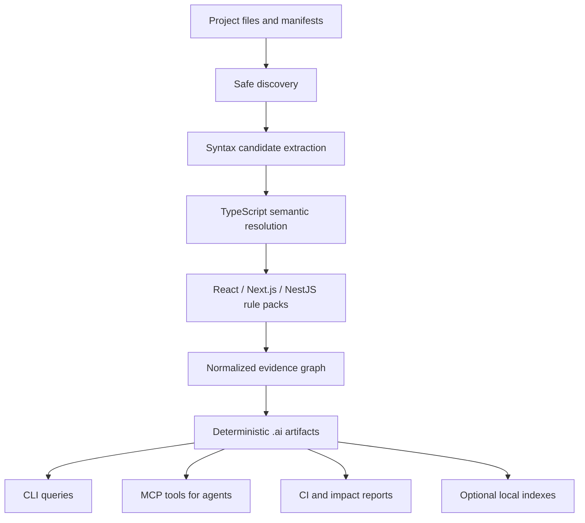

# AI Code Map: Project Vision and Architecture

> Status: living product and architecture document for the open-source project.

## One-sentence idea

AI Code Map builds a compact, deterministic, evidence-backed semantic map of a codebase so AI coding agents can understand structure, plan changes, and locate relevant code before reading full source files.

## The problem

Coding agents commonly begin a task by repeatedly searching and opening files. This has several costs:

- large repositories consume unnecessary context tokens;
- important relationships are scattered across files and framework conventions;
- agents spend time rediscovering the same architecture on every task;
- planning quality depends on which files happened to be opened first;
- stale summaries can look correct while no longer matching the source;
- plain file trees and embeddings do not explain why two code elements are related.

A file list is too shallow, while copying an entire repository into an AI context is too expensive. The missing layer is a small, queryable semantic representation between source code and the agent.

## Product thesis

The project should generate the map with deterministic static analysis, not with an LLM.

An AI agent should use the map as its first navigation and planning layer:

1. inspect project structure and map freshness;
2. locate relevant symbols, routes, components, providers, and relations;
3. build a proposed change surface within a context budget;
4. open only the source files needed to verify and implement the change.

The map reduces blind code reading; it does not replace source code as the final authority.

## Design principles

1. **Local first** — scanning works offline and does not upload source code.
2. **Deterministic** — the same source, configuration, and analyzer versions produce byte-identical canonical artifacts.
3. **Evidence backed** — every inferred relation includes provenance, location, and confidence.
4. **Framework aware** — the map understands React, Next.js, Node.js, and NestJS concepts rather than exposing only generic AST nodes.
5. **Safe by default** — scanning never executes application code or dynamically loads project configuration.
6. **Incremental** — unchanged work should be reusable, and freshness must be explicit.
7. **Open format** — the `.ai` artifact format is versioned and independent of any parser, graph library, database, or AI vendor.
8. **Graceful degradation** — malformed files and unresolved dependencies create diagnostics instead of aborting the entire scan.
9. **Measurable value** — token reduction, retrieval quality, scan performance, and planning quality must be benchmarked rather than assumed.

## System model



### 1. Safe discovery

Discovery determines the project root, workspaces, TypeScript projects, entry points, and eligible source files.

It must:

- understand pnpm, npm, Yarn, Bun, Lerna, and Rush-style workspaces;
- respect configured include/exclude patterns and `.gitignore` semantics;
- avoid generated output, dependencies, `.git`, and the `.ai` directory;
- disable symlink traversal by default;
- resolve real paths and reject files outside the project root;
- discover separate `tsconfig` projects and project references.

Commodity discovery behavior should be reused from established libraries instead of reimplemented.

### 2. Hybrid parsing

Tree-sitter and the TypeScript compiler solve different problems and should be used as separate layers.

#### Syntax layer

Tree-sitter, potentially through an `ast-grep` adapter, is responsible for fast and error-tolerant syntactic candidates:

- imports and exports;
- declarations and calls;
- JSX elements;
- React hook-shaped calls;
- Next.js filesystem conventions;
- NestJS decorator-shaped syntax;
- partially invalid files.

This layer answers: **“What structures might be present?”**

#### Semantic layer

The TypeScript `Program` and `TypeChecker` remain authoritative for:

- symbol identity;
- aliases and re-exports;
- import and path resolution;
- inferred and declared types;
- overloads and signatures;
- definitions and references across files;
- confirmation that an API came from React, Next.js, NestJS, or another package.

This layer answers: **“What does this structure actually refer to?”**

The scanner must avoid blindly walking two complete trees for every file. The syntax layer should narrow candidates where that improves measured performance, and the semantic layer should confirm only facts that require compiler knowledge. Both implementations remain replaceable behind adapters.

### 3. Framework rule packs

Framework analyzers translate generic syntax and semantic facts into concepts useful to developers and AI agents.

#### React

- components and custom hooks;
- props and public signatures;
- `useState` and `useReducer` state;
- `useMemo`, `useCallback`, and effects;
- dependency arrays;
- memoization and `forwardRef` wrappers;
- rendered component relationships;
- client/server runtime hints.

#### Next.js

- App Router and Pages Router routes;
- pages, layouts, route handlers, middleware, and special files;
- dynamic and catch-all route parameters;
- HTTP methods and runtime hints;
- layout chains and route relationships.

#### Node.js and TypeScript

- modules, imports, exports, and re-exports;
- functions, classes, methods, interfaces, and types;
- calls, construction, references, and external operations;
- environment-variable names without capturing their values;
- filesystem, HTTP, database, and queue interaction hints.

#### NestJS

- modules, controllers, providers, DTOs, guards, pipes, filters, interceptors, and gateways;
- HTTP routes and method decorators;
- dependency injection;
- controller/provider module membership;
- DTO consumption and framework relationships.

Rule packs must be versioned because a rule change can make an existing map stale.

## Example transformation

Given source code similar to:

```tsx
export const UserList = memo(function UserList({ users }: Props) {
  const [filter, setFilter] = useState("");
  const visibleUsers = useMemo(
    () => users.filter((user) => user.name.includes(filter)),
    [users, filter],
  );

  return visibleUsers.map((user) => <UserRow key={user.id} user={user} />);
});
```

The map should express compact facts such as:

```text
symbol: React component UserList
props: Props
wrapper: memo
state: filter, setter setFilter
memoized value: visibleUsers
memo dependencies: users, filter
renders: UserRow
```

Each non-trivial fact should point back to a source file and range. The public map stores normalized facts, not Tree-sitter nodes or TypeScript compiler objects.

## Canonical map

The default output lives under `.ai/code-map/`.

| Artifact           | Purpose                                                          |
| ------------------ | ---------------------------------------------------------------- |
| `config.json`      | Scanner configuration                                            |
| `overview.md`      | Small human- and AI-readable project overview                    |
| `manifest.json`    | Schema/analyzer versions, configuration hash, and source hashes  |
| `project.json`     | Project, workspace, framework, entry-point, and count metadata   |
| `files.jsonl`      | File-level facts, imports, exports, hashes, and syntax summaries |
| `symbols.jsonl`    | Normalized symbols and framework-specific facts                  |
| `relations.jsonl`  | Directed, evidence-backed relationships                          |
| `diagnostics.json` | Parse, resolution, fallback, and analysis diagnostics            |

JSONL is the canonical alpha storage because it is streamable, diffable, portable, and easy to inspect. Graph or search indexes are rebuildable derivatives and must not define the public format.

### Core entities

- **Project** — repository and workspace metadata.
- **File** — normalized path, language, hash, imports, exports, and detected frameworks.
- **Symbol** — stable identity, kind, signature, range, documentation, and facts.
- **Relation** — typed edge between files, symbols, routes, or external systems.
- **Evidence** — parser/analyzer, origin, source location, exactness, and confidence.
- **Diagnostic** — recoverable uncertainty or failure that affects map quality.

### Representative relations

```text
imports        renders         uses-hook
calls          references      depends-on
injects        handles-route   consumes-dto
contains       uses-layout     belongs-to-module
```

Stable IDs must survive unrelated edits whenever the underlying logical symbol has not changed.

## Freshness and incremental behavior

A map is usable only when its freshness is visible.

The freshness key should include:

- source paths and content hashes;
- normalized configuration;
- schema version;
- scanner version;
- syntax-parser version;
- enabled analyzer and rule-pack versions;
- relevant TypeScript project configuration.

Added, modified, deleted, and moved files must be reported explicitly. A completed scan removes obsolete records and orphaned relations. The manifest is committed last so readers do not observe a new manifest paired with incomplete data.

For one-shot CLI scans, incremental Tree-sitter parsing may provide limited value because the old tree is not retained. Its largest benefit appears in a later long-lived watch or MCP process, where syntax trees and TypeScript builder state can remain in memory.

## Interfaces and extension boundaries

The architecture should expose narrow contracts rather than library-specific objects:

- `WorkspaceDiscovery` — projects, workspaces, configs, and files;
- `SyntaxParserAdapter` — syntax facts and recoverable issues;
- `SemanticResolver` — canonical symbols, types, definitions, and references;
- `FrameworkAnalyzer` — versioned framework-specific contributions;
- `MapEnricher` — optional facts imported from existing artifacts;
- `MapStore` — deterministic persistence and loading;
- `QueryEngine` — symbol lookup, neighbors, paths, impact, and context selection;
- `TokenEstimator` — replaceable context-budget estimation.

Third-party extensions must declare capabilities and versions explicitly. Extension versions participate in freshness checks.

## User workflow

The initial CLI remains small and deterministic:

```bash
pnpm exec ai-code-map init
pnpm exec ai-code-map scan
pnpm exec ai-code-map check
pnpm exec ai-code-map show UserList
```

The first release does not need to pretend that static analysis understands arbitrary natural-language tasks. Later, an AI integration can combine deterministic primitives such as:

```text
find symbols matching "user"
show UserList with inbound and outbound relations
find paths from users route to UserList
list symbols impacted by UserService
assemble selected facts within a 4,000-token budget
```

An MCP server should expose these as small, read-only tools. The AI agent performs task interpretation; the code-map engine supplies verified project facts.

## Reuse strategy

The project should reuse commodity infrastructure and own its semantic product layer.

### Reuse now

| Concern                | Preferred building block                    |
| ---------------------- | ------------------------------------------- |
| CLI                    | Commander                                   |
| File matching          | fast-glob                                   |
| Workspace discovery    | `@manypkg/get-packages` behind an adapter   |
| Ignore rules           | `ignore` or an explicitly tested equivalent |
| Syntax parsing         | Tree-sitter, with an `ast-grep` benchmark   |
| TypeScript semantics   | TypeScript Compiler/Language Service API    |
| Runtime validation     | Zod                                         |
| JSON Schema generation | Zod `toJSONSchema()`                        |
| Hashing                | Node.js `crypto` SHA-256                    |
| Testing and packaging  | Vitest and tsup                             |

### Reuse later

| Concern                               | Candidate                                      |
| ------------------------------------- | ---------------------------------------------- |
| Graph traversal and impact algorithms | Graphology                                     |
| Local lexical search                  | MiniSearch                                     |
| Watch mode                            | Chokidar                                       |
| Agent protocol                        | Official MCP TypeScript SDK over local `stdio` |
| Definition/reference interchange      | SCIP                                           |
| CI diagnostics                        | SARIF                                          |
| Existing API contracts                | Safe OpenAPI and GraphQL importers             |
| Test evidence                         | Istanbul coverage import                       |

### Own as project value

- the normalized and versioned Code Map IR;
- stable identity and deterministic serialization;
- evidence, provenance, and confidence semantics;
- React, Next.js, Node.js, and NestJS rule packs;
- cross-framework feature-flow construction;
- freshness and invalidation behavior;
- change-surface and impact ranking;
- context selection under a token budget;
- the evaluation corpus and quality benchmarks.

## Explicit non-goals

The core scanner should not:

- use an LLM to generate canonical map facts;
- execute the target application;
- import `next.config`, bootstrap NestJS modules, or run arbitrary plugins;
- store full source files or arbitrary string literals;
- read `.env` values or include secrets;
- depend on private Next.js or NestJS runtime internals;
- expose parser-specific AST objects in the public format;
- require Neo4j, SQLite, a vector database, or a cloud account for the alpha;
- replace the TypeScript compiler with `ts-morph` without measured benefit;
- make dependency-cruiser or react-docgen an authoritative second semantic engine.

## Optional evidence importers

When a repository already contains trustworthy generated artifacts, the map should consume them instead of reverse-engineering the same information:

- OpenAPI specifications for endpoints and schemas;
- GraphQL SDL or introspection results for operations and types;
- coverage JSON for test-to-code evidence;
- CODEOWNERS for ownership hints;
- Storybook metadata for component stories;
- existing SCIP indexes for definitions and references;
- existing OpenTelemetry traces for explicitly labeled runtime-observed edges.

Importers are opt-in, sandboxed, network-disabled by default, and constrained to files inside the repository. Runtime observations supplement static facts and never silently override them.

## Security and privacy contract

- Never execute scanned source or configuration.
- Never follow an unresolved symlink outside the selected repository.
- Never perform network access during a normal scan.
- Never persist arbitrary source snippets by default.
- Record environment-variable names only, never their values.
- Redact string literals from signatures and summaries unless a narrowly defined rule explicitly permits them.
- Treat parser failures and unresolved imports as diagnostics, not permission to fall back to unsafe execution.
- Write only managed artifacts inside the configured output directory.
- Keep canonical writes atomic and deterministic.

## Evaluation plan

The project hypothesis must be tested against a baseline in which an agent only has repository search and source files.

### Map quality

- precision and recall for symbols and relations;
- React/Next.js/NestJS fixture accuracy;
- percentage of facts carrying exact source evidence;
- malformed-file recovery;
- stable-ID survival across common edits.

### Performance

- cold scan time;
- warm/watch update time;
- peak memory usage;
- output size;
- installation and packaging behavior on macOS, Linux, and Windows.

### AI usefulness

- tokens consumed before producing a valid implementation plan;
- time to identify the correct change surface;
- relevant-file recall and irrelevant-file reduction;
- plan accuracy;
- implementation success rate after map-first navigation.

Tree-sitter, `ast-grep`, and compiler-only scanning should be compared on the same repositories. A dependency enters the default runtime only when the benchmark shows a clear accuracy, performance, or maintainability benefit.

## Open-source and commercial direction

The open-source core should remain genuinely useful on a local repository:

- deterministic scanning;
- the open `.ai` schema;
- baseline framework analyzers;
- CLI queries;
- local read-only MCP integration;
- freshness and CI checks.

Potential commercial capabilities can build on top without weakening the open core:

- organization-wide and cross-repository maps;
- map history and architectural drift;
- pull-request impact and risk analysis;
- team ownership and policy enforcement;
- private framework rule packs;
- shared indexing, access control, and audit logs;
- quality dashboards and evaluation reports;
- integrations with hosted source-control and issue-tracking systems.

The commercial value is coordination, history, scale, and governance—not locking the basic local map behind a hosted service.

## Delivery sequence

### Alpha

- deterministic local scanner and `.ai/code-map` artifacts;
- TypeScript/JavaScript core facts;
- React behavior facts;
- parser adapter with TypeScript semantics remaining authoritative;
- `init`, `scan`, `check`, and `show`;
- security, determinism, freshness, and malformed-source tests.

### Beta

- mature Next.js and NestJS rule packs;
- correct monorepo and project-reference discovery;
- graph queries, impact analysis, and local lexical search;
- long-lived watch mode;
- read-only MCP tools;
- benchmark suite on representative repositories.

### Later

- optional SCIP, SARIF, OpenAPI, GraphQL, coverage, and runtime-evidence adapters;
- task-oriented context assembly with explicit budgets;
- CI and pull-request reports;
- cross-repository and team features.

## Final product boundary

Parsing, compiler resolution, graph algorithms, search, filesystem watching, and transport protocols are reusable building blocks.

The product is the trustworthy layer that converts those building blocks into a compact, framework-aware, versioned, and evidence-backed model that an AI agent can use to plan software changes with less code reading and less wasted context.
